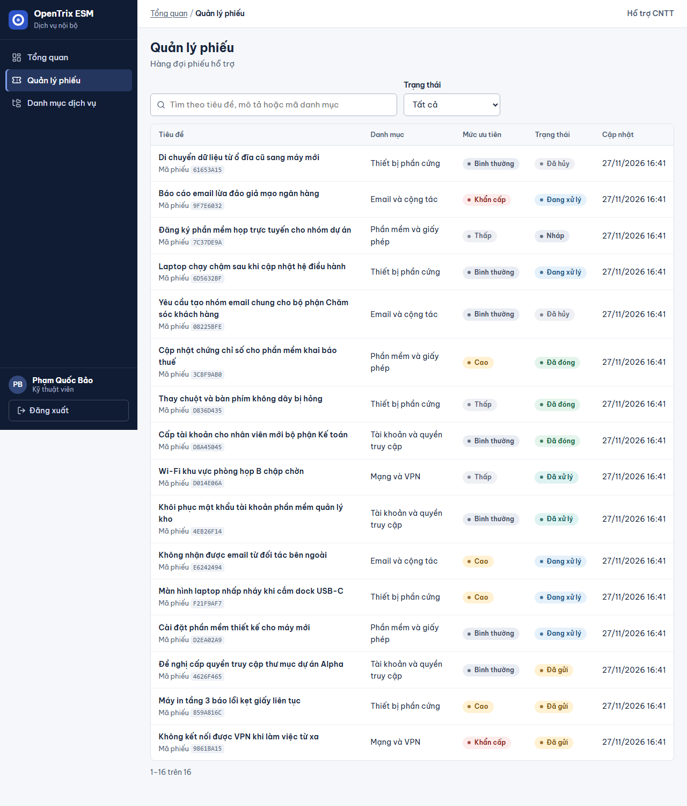
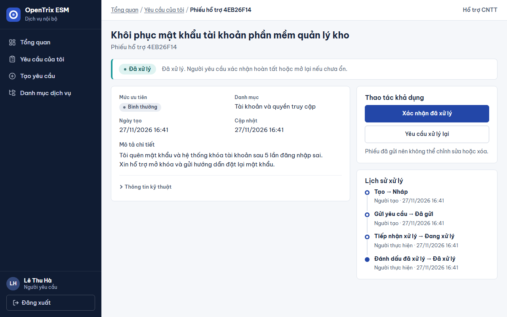
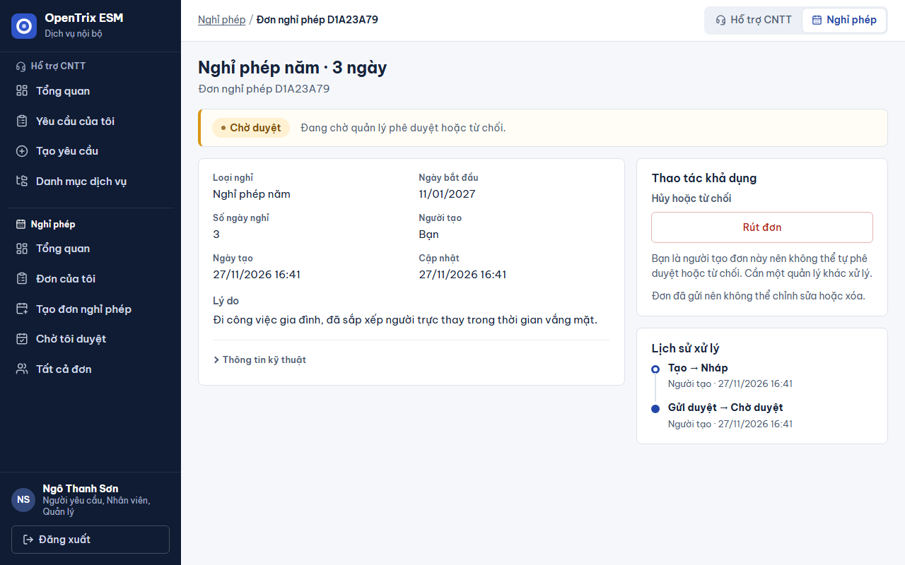
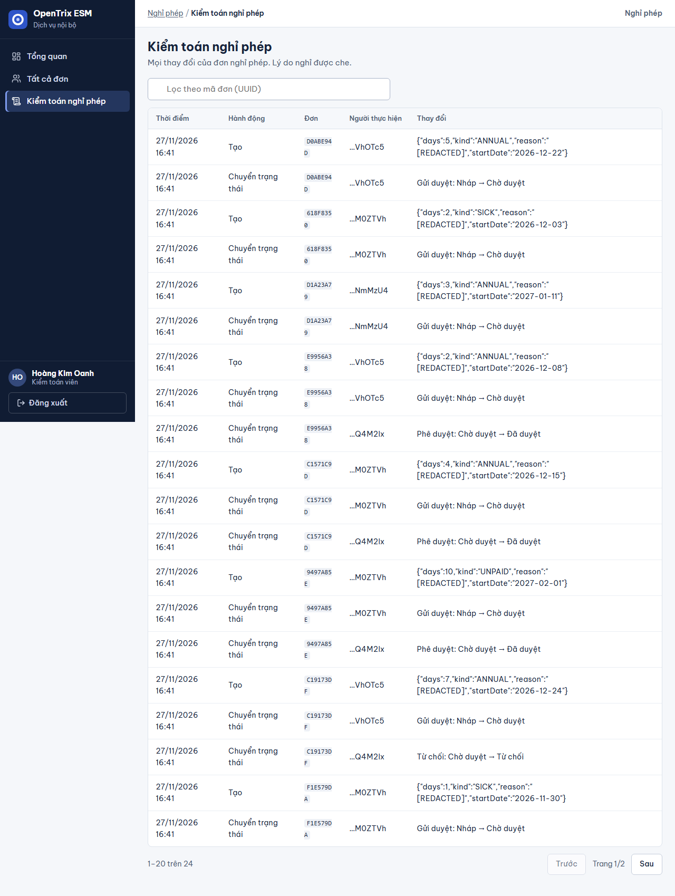

<!--
SPDX-FileCopyrightText: 2026 OpenTrix ESM contributors
SPDX-License-Identifier: Apache-2.0
-->

# OpenTrix ESM — IT Helpdesk and HR Leave

OpenTrix ESM is an **independent enterprise service management application**. It is built on the public API of the
[OpenTrix Platform](https://github.com/lexuanbao258-collab/opentrix-v1-candidate) (Enterprise Application Foundation)
and does not modify, import or share a database with it.

This repository delivers **M3: IT Helpdesk** — service categories, support tickets, a role-based ticket workflow,
history and audit — and **M4: HR Leave** — leave requests with a manager approval workflow, history and an auditor-only
audit view — as one React + TypeScript application with its own backend-for-frontend (BFF). Both modules use the same
shell, API client, forms, tables, workflow actions, history/audit components and BFF security; each user sees only the
modules in which the Platform says they hold a role.

> **Status: a competition-ready, self-hosted demonstration candidate. It is not a production-certified system**
> and carries no upstream approval. Local stack, synthetic data only. Limitations:
> [Platform security and limitations](https://github.com/lexuanbao258-collab/opentrix-v1-candidate/blob/621c32999668203f40363009aabe83ec66287c37/docs/candidate/SECURITY-LIMITATIONS.md) and [Known limitations](docs/evidence/M3-evidence.md#7-known-limitations).

**Documentation:** [Platform product overview](https://github.com/lexuanbao258-collab/opentrix-v1-candidate/blob/621c32999668203f40363009aabe83ec66287c37/docs/candidate/README.md) ·
[Developer guide](https://github.com/lexuanbao258-collab/opentrix-v1-candidate/blob/621c32999668203f40363009aabe83ec66287c37/docs/candidate/DEVELOPER-GUIDE.md) · [API guide](https://github.com/lexuanbao258-collab/opentrix-v1-candidate/blob/621c32999668203f40363009aabe83ec66287c37/docs/candidate/API-GUIDE.md) · [Architecture](https://github.com/lexuanbao258-collab/opentrix-v1-candidate/blob/621c32999668203f40363009aabe83ec66287c37/docs/candidate/ARCHITECTURE.md) ·
[Validation summary](https://github.com/lexuanbao258-collab/opentrix-v1-candidate/blob/621c32999668203f40363009aabe83ec66287c37/docs/candidate/VALIDATION.md) · [ESM development guide](docs/DEVELOPMENT.md) · evidence:
[M3](docs/evidence/M3-evidence.md), [M4](docs/evidence/M4-evidence.md), [M6.2](docs/evidence/M62-evidence.md).

## What it looks like

Real screenshots from the M6.2 build (desktop 1280×800), taken on a **separate, disposable stack seeded with a small
curated fictional dataset through the public API** (5 categories, 16 tickets, 10 leave requests). The names and
requests are invented; they are demonstration data, not regression fixtures and not usage statistics. All records share
one creation timestamp because the API cannot back-date. The UI is Vietnamese-first. More screenshots, including
mobile, are in [`docs/evidence/m62/after/`](docs/evidence/m62/after/).

| IT Helpdesk: agent queue | IT Helpdesk: resolved ticket with workflow history |
| --- | --- |
|  |  |

| HR Leave: creator cannot approve (`notByCreator`) | HR Leave: auditor view, reason redacted |
| --- | --- |
|  |  |

```
Browser ──HTTPS/HTTP──> ESM BFF (Node) ──Bearer token (server-side)──> Platform ingress (Caddy) ──> Platform API
   SPA (React)           OIDC code+PKCE, CSRF,                          method/path allowlist         (Spring Boot)
   no tokens             route allowlist, sessions                       │
                                                                          └── PostgreSQL (Platform only)
                                   Keycloak (OIDC) <── sign-in redirect ── browser
```

| Part | Directory | What it is |
| --- | --- | --- |
| Application manifests | `manifests/it-helpdesk/app.json`, `manifests/hr-leave/app.json` | `it-helpdesk` **1.1.0**: `category` (unchanged from 1.0.0) + `ticket` entity and workflow. `hr-leave` **1.1.0**: the Platform baseline's manifest, byte-identical |
| BFF | `bff/` | Express 5 + `openid-client`: Authorization Code + PKCE, server-side sessions, CSRF, per-application allowlist proxy |
| Web | `web/` | React 19 + Vite + TypeScript SPA, Vietnamese-first |
| E2E | `e2e/` | Playwright against real PostgreSQL + Keycloak + Platform |
| Deployment helpers | `deploy/` | Platform stack overlay, Keycloak client/user provisioning, upgrade checks |

## Ticket workflow (enforced by the Platform, not by this UI)

```
DRAFT ──submit──> SUBMITTED ──start──> IN_PROGRESS ──resolve──> RESOLVED ──confirm──> CLOSED
  │                  │                     ^                        │
  └──discard──┐      └──cancel──┐          └──────reopen────────────┘
              v                 v
           CANCELLED         CANCELLED
```

| Transition | Who (manifest) |
| --- | --- |
| `submit`, `discard`, `cancel`, `confirm`, `reopen` | requester, only for tickets they created (`own`) |
| `start`, `resolve` | agent or administrator, any ticket, **never the ticket's creator** (`notByCreator`) |
| edit / delete | requester, own ticket, only in `DRAFT` (other states are locked) |
| read | requester: own tickets; agent and administrator: all |
| audit | administrator only; the ticket description is marked `sensitive` and is redacted in audit |

## Leave request workflow (HR Leave; enforced by the Platform)

```
DRAFT ──submit──> PENDING ──approve──> APPROVED
  │                  │   └──reject───> REJECTED
  └──discard──┐      └──withdraw──┐
              v                   v
           CANCELLED          CANCELLED
```

| Transition | Who (manifest) |
| --- | --- |
| `submit`, `discard`, `withdraw` | employee, only for requests they created (`own`) |
| `approve`, `reject` | manager, any request, **never the request's creator** (`notByCreator`) |
| edit / delete | employee, own request, only in `DRAFT` |
| read | employee: own; manager and auditor: all |
| audit | auditor only; the leave reason is `sensitive` and is redacted in audit |

A person holding both `employee` and `manager` can create requests but the Platform refuses (403) their own
approve/reject; another manager must decide. The Platform has no leave balances, calendars or approver routing: ESM does
not pretend otherwise.

The Platform does **not** provide assignee-based authorization, referential integrity between entities, comments
or aggregates. ESM does not pretend otherwise: tickets store a category *code*, there is no assignee, and dashboard
numbers are computed from authorized API pages and labelled when truncated.

## Quick start

Tested in M6.3 on Windows 11 with Git Bash, Docker Desktop (Engine 29.7.2, Compose 5.4.0), Node 24.19.0; Linux and macOS
are **not verified**. Needs Node 22.12+, Docker Compose 2.24.4+, Git Bash (Windows) or bash, `openssl`, and `curl`.
The Platform runtime is frozen at `f401b6e79930a1386e71e92a91ae6a909cfa1e59`. The ESM overlay uses the Platform deployment
at `179d61d31069ce1a1bf246f35722d3a66cad0a93`. This standalone example selects ESM's accepted documentation commit
`479d4e7a8f44f91a7c45a9265bd3f1a1407ea1f3`, which contains the M6.2 application/workflows. To reproduce M6.4, use the exact
candidate SHAs in the release manifest. Keep 20 GB free and stop below 10 GB. See the
[development guide](docs/DEVELOPMENT.md#2-local-stack) for recovery and verification.

```bash
git clone --no-checkout https://github.com/lexuanbao258-collab/opentrix-v1-candidate.git opentrix-v1-candidate
git -C opentrix-v1-candidate checkout --detach 179d61d31069ce1a1bf246f35722d3a66cad0a93
git clone --no-checkout https://github.com/lexuanbao258-collab/opentrix-enterprise-demo.git opentrix-enterprise-demo
git -C opentrix-enterprise-demo checkout --detach 479d4e7a8f44f91a7c45a9265bd3f1a1407ea1f3
cd opentrix-enterprise-demo
export PLATFORM_DIR="$PWD/../opentrix-v1-candidate"
. deploy/settings.sh
deploy/platform-stack.sh up                 # PostgreSQL, Keycloak, Platform backend, HTTPS ingress; registers manifests/
deploy/provision-keycloak.sh                # ESM OIDC client + demo users; random passwords in .local/esm.env
docker cp "$ESM_STACK_PROJECT-ingress-1:/data/caddy/pki/authorities/local/root.crt" "$ESM_LOCAL_DIR/caddy-root.crt"
(cd bff && npm ci && npm run build) && (cd web && npm ci && npm run build)
deploy/run-bff-local.sh                     # http://localhost:5174 (foreground)
```

- **Credentials.** Generated locally and never committed: `.local/esm.env` (users) and `.local/platform.env` (stack).
  Read one value only when you need it, for example `grep '^ESM_PASSWORD_AGENT=' .local/esm.env`. The demo users are
  listed in [docs/DEVELOPMENT.md](docs/DEVELOPMENT.md#run-esm).
- **Health.** `docker compose -p "$ESM_STACK_PROJECT" ps` shows postgres and keycloak `healthy`; `curl http://localhost:5174/bff/session` answers
  before sign-in; signing in as a demo user shows only the modules that user's roles allow.
- **Stop without deleting data.** `deploy/platform-stack.sh down` and Ctrl+C in the BFF terminal. Never run
  `deploy/platform-stack.sh reset` or `docker compose down -v` unless you intend to delete the stack's data.
- **Parallel stacks.** Set `ESM_STACK_PROJECT`, `ESM_PLATFORM_HTTPS_PORT`, `ESM_KEYCLOAK_PORT`, `ESM_PORT`.
- If Docker reports `all predefined address pools have been fully subnetted`, see the Quick Start troubleshooting table.

## Tests

```bash
(cd bff && npm test)            # BFF: 25 passed at 7b191c5 (re-run in M6.3)
(cd web && npm test)            # web: 68 passed at 7b191c5 (re-run in M6.3)
(cd e2e && npm ci && npx playwright install chromium && npx playwright test)   # real stack; 119 passed, 0 failed, 4 skipped in M6.2
node scripts/scan-secrets.mjs   # SECRET_SCAN_PASS in M6.3
```

The suites overlap with earlier milestones; do not add counts across milestones. Provenance of every number:
[Validation summary](https://github.com/lexuanbao258-collab/opentrix-v1-candidate/blob/621c32999668203f40363009aabe83ec66287c37/docs/candidate/VALIDATION.md).

## Limitations

In-memory BFF sessions, no rate limiting, demo-mode Keycloak, no leave balances or approver routing, no assignee or
comments, no referential integrity between ticket and category, lists and dashboards scan at most 500 authorized
records client-side, Chromium-only automated browser checks.

## License and attribution

Apache-2.0 ([LICENSE](LICENSE)). Original authorship, reused Platform manifests and fonts are recorded in
[NOTICE](NOTICE); npm dependencies in [THIRD-PARTY-NOTICES.md](THIRD-PARTY-NOTICES.md). AI-assisted development is
disclosed in NOTICE (Codex for the M6.1-FIX deployment, tests and documentation; Claude for the M6.3 documentation);
the owner should confirm the complete tool list. Candidate work carries no upstream approval.
